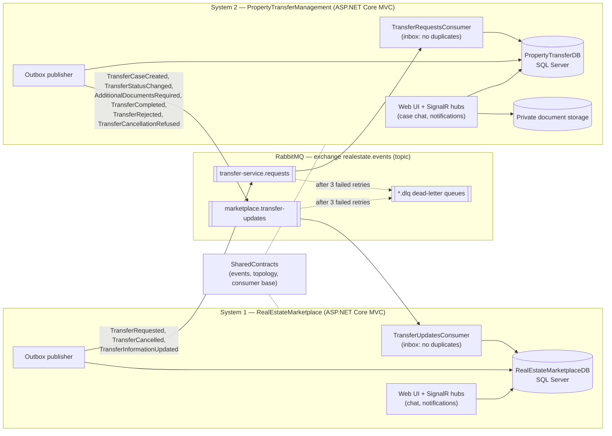

# Real Estate Marketplace & Property Ownership Transfer

Two independent ASP.NET Core MVC applications that talk only through RabbitMQ.

| Project | What it is | Database | URL (dev) |
|---|---|---|---|
| `RealEstateMarketplace` | System 1: listings, search, chat, transactions | `RealEstateMarketplaceDB` | https://localhost:7287 |
| `PropertyTransferManagement` | System 2: ownership-transfer cases, documents, officers | `PropertyTransferDB` | https://localhost:7041 |
| `SharedContracts` | Message contracts + shared RabbitMQ topology/consumer | none | none |

## Architecture



Each system has its own database and its own login. They never call each other directly:
every change travels as a message through RabbitMQ, so either system can be offline for a while.

## Run locally

**One command (macOS / Linux):** `./run.sh` starts Docker, SQL Server, RabbitMQ and both apps,
then opens them in the browser. Press Ctrl+C to stop both apps.
`./run.sh marketplace` or `./run.sh transfer` starts only one system, so each can run in its own
terminal and be stopped alone (e.g. to show RabbitMQ keeping messages while System 2 is down).
Step-by-step guide with test scenarios: [docs/Run-and-Test-Guide.pdf](docs/Run-and-Test-Guide.pdf).

### Windows (SQL Server Express)
`appsettings.json` already points at `.\SQLEXPRESS`. Install RabbitMQ (or run only the
`rabbitmq` service from `docker-compose.yml`), then run both projects.

### macOS / Linux (Docker)
```bash
docker compose up -d
cp RealEstateMarketplace/appsettings.Development.example.json RealEstateMarketplace/appsettings.Development.json
cp PropertyTransferManagement/appsettings.Development.example.json PropertyTransferManagement/appsettings.Development.json
dotnet run --project RealEstateMarketplace --launch-profile https
dotnet run --project PropertyTransferManagement --launch-profile https
```

In Development, both apps apply EF Core migrations at startup and seed:
- System 1: the `Admin` role, plus the `SeedAdmin` account from `appsettings.Development.json`.
- System 2: the `Admin` and `Officer` roles, the document types, plus the `SeedUsers` accounts.

**Email:** if `SmtpSettings` are not configured (keep them in user-secrets, never in git),
emails are printed to the app console (search for `DEV EMAIL`). Both systems verify new accounts
with a 6-digit code that appears there.

RabbitMQ management UI: http://localhost:15672 (guest / guest).

**Automated tests:** `dotnet test` runs both test projects. No database or RabbitMQ needed.
- `RealEstate.Tests` (System 1): rental start/end, who may review, saved-search map area, and how
  transfer updates and cancellations are handled.
- `PropertyTransfer.Tests` (System 2): case creation, duplicates, cancel / refused cancel, name updates,
  and missing-document reminders.

**Health checks:** https://localhost:7287/health and https://localhost:7041/health show whether each app
can reach its database and RabbitMQ.

### Optional: AI search (free)
AI search works without any key: a built-in reader understands common English requests.
To use a real language model, set an OpenAI-compatible endpoint in user-secrets:

```bash
cd RealEstateMarketplace
dotnet user-secrets set "AiSearch:BaseUrl" "https://generativelanguage.googleapis.com/v1beta/openai/"
dotnet user-secrets set "AiSearch:ApiKey" "<free key from Google AI Studio>"
```

Or run a local model with Ollama (no key): set `AiSearch:BaseUrl` to `http://localhost:11434/v1/` and `AiSearch:Model` to e.g. `llama3.2`.
Only the search sentence is sent. The model returns filters, and every result is a real listing from the database.

## Features

**System 1 — Marketplace**
- Registration with optional ID OCR (Tesseract.js, runs in the browser, the picture is never uploaded) and a 6-digit email code
- Forgot password: a 6-digit reset code by email, then the new password twice (wrong codes count towards lockout)
- Listings with facilities, rental period / installments, GPS or map location, photos; admin approval (edits go back to moderation)
- Search: filters, interactive map (Leaflet + OpenStreetMap), distance from a clicked point or "my location"
- AI search (free OpenAI-compatible endpoint or built-in reader), rate limited
- Favorites with a side-by-side comparison table, live chat with owners (SignalR), live notifications
- Saved searches keep every filter, including the area on the map; a newly approved matching listing sends a notification (and an email if switched on)
- Changing your name while a transfer is open updates the case in System 2 (`TransferInformationUpdated`)
- Transactions, rental agreements, ownership-transfer request to System 2 and live status from RabbitMQ; buyer or seller can cancel the request (`TransferCancelled`); System 2 confirms the cancel, or refuses it once official processing has started, so both systems always agree
- Rentals move on by date: a scheduled rental becomes active on its start date; after the end date it is completed and the listing is available again
- Reviews only after a completed sale or a started rental
- Optional profile picture (JPG / PNG / WebP, checked by file signature)
- Report a listing; admin investigates and dismisses, requests corrections, hides, removes or suspends the owner
- Promoted listings paid through a test payment gateway (`4242 4242 4242 4242` succeeds, `4000 0000 0000 0002` is declined)
- Admin: dashboard with Chart.js charts, most viewed properties, sale / rent counts, users (suspend / reactivate / roles), all listings, reviews, payments, PDF + Excel exports

**System 2 — Transfer service**
- Registration with a 6-digit email code (a separate account from the Marketplace)
- Cases created from RabbitMQ, buyer/seller linked by confirmed email, document checklist and review
- OCR on uploaded JPG/PNG documents (Tesseract.js in the browser): the text is shown, the uploader checks and corrects it,
  and the officer sees it marked "not verified" next to the document
- Officer assignment, status workflow, official completion record, audit log
- Admin manages staff: create officers, give or remove the Officer / Admin role, deactivate / reactivate accounts
  (an officer with active cases must have them reassigned first; there is always at least one active admin)
- Officer dashboard: assigned, new, to review, waiting for users, upcoming appointments, ready for processing, completed
- Automatic reminders (in-app + email) when mandatory documents are still missing 2 days after they were requested, then every 3 days
- Live chat: buyer ↔ officer, seller ↔ officer (private) and a shared case thread
- Live notifications (SignalR) and email copies of appointments, with 24-hour reminders
- Appointments: schedule, reschedule, complete, cancel
- Housing-loan assistance: the officer records the lender and the lender's decision (the service never approves loans)
- Optional assistance-service fees through the test gateway (clearly not government fees)
- Admin statistics (transfers, officers, payments, loans) with Chart.js, PDF + Excel exports

Free tools only: QuestPDF Community licence, ClosedXML (MIT), Chart.js, Leaflet/OpenStreetMap, Tesseract.js, SignalR.

## RabbitMQ message catalogue

Exchange `realestate.events` (topic, durable). Dead letters go to `realestate.events.dlx` and then the `*.dlq` queues.

| Message | Direction | Routing key | Queue |
|---|---|---|---|
| `TransferRequested` | 1 → 2 | `marketplace.transfer.requested` | `transfer-service.requests` |
| `TransferCancelled` | 1 → 2 | `marketplace.transfer.cancelled` | `transfer-service.requests` |
| `TransferInformationUpdated` | 1 → 2 | `marketplace.transfer.information-updated` | `transfer-service.requests` |
| `TransferCaseCreated` | 2 → 1 | `transfer.case.created` | `marketplace.transfer-updates` |
| `TransferStatusChanged` | 2 → 1 | `transfer.case.status-changed` | `marketplace.transfer-updates` |
| `AdditionalDocumentsRequired` | 2 → 1 | `transfer.case.documents-required` | `marketplace.transfer-updates` |
| `TransferCompleted` | 2 → 1 | `transfer.case.completed` | `marketplace.transfer-updates` |
| `TransferRejected` | 2 → 1 | `transfer.case.rejected` | `marketplace.transfer-updates` |
| `TransferCancellationRefused` | 2 → 1 | `transfer.case.cancellation-refused` | `marketplace.transfer-updates` |

`TransferInformationUpdated` is sent when the buyer or seller changes their name in the Marketplace while
the transfer is open; the case shows the new name, records it in the history and tells the officer.

Two messages from the proposal are not needed in this design:
- `TransferInitiationConfirmed`: both parties confirm the deal in the Marketplace *before* the buyer can request
  the transfer, so `TransferRequested` already means "both confirmed". The seller then confirms participation
  inside System 2.
- `TransactionDetailsCorrected`: the agreed price and property are locked once both parties confirm. To change
  them, the request is cancelled (`TransferCancelled`) and a new one is sent.

How the messaging stays reliable:
- **Outbox:** the business change and its `OutboxMessages` row are saved in one transaction. A background
  publisher sends pending rows with publisher confirms and retries while RabbitMQ is down.
- **Durable queues + persistent messages:** both apps declare the whole topology, so messages wait in
  the queue while the other app is offline.
- **Consumers:** `BackgroundService` with manual acks and prefetch 1. A failed message is retried 3 times,
  then dead-lettered.
- **Inbox:** `InboxMessages.MessageId` (unique) prevents processing the same message twice.
- Events carry only names, emails, property data and statuses. ID images, documents and chats never leave their system.

## Demo flow

1. System 1: a seller publishes a sale listing, and the admin approves it.
2. The buyer sends a purchase request, the seller accepts it, and both confirm the transaction in **My Transactions**.
3. The buyer clicks **Request Ownership Transfer**. This publishes `TransferRequested`.
4. System 2 creates case `TR-2026-0001` and replies with `TransferCaseCreated`. System 1 shows the case number.
5. System 2 admin (**Case Queue**) assigns the officer. The status becomes *Awaiting Documents*.
6. Buyer and seller register in System 2 **with the same email** and enter the 6-digit code from the email. The case is linked automatically. Each uploads their documents.
7. The officer accepts the documents, or marks one *Replacement required*. That sends `AdditionalDocumentsRequired` to System 1.
8. The officer moves the case to *Ready for Processing*, then *External Processing in Progress*, then **Record official completion**.
   This sends `TransferCompleted`: the System 1 transaction becomes *Completed* and the listing *Sold*.
9. Resilience: stop System 2, request another transfer in System 1, restart System 2. The queued message is processed.
10. During the case: chat in the **Messages** panel, schedule an appointment as the officer, request loan
    assistance as the buyer, buy an assistance service with the test card.
11. After completion, the buyer leaves a review in System 1 (**My Transactions → Leave a review**).
12. Admins: System 1 **Admin → Dashboard** and System 2 **Statistics** show the charts; export to Excel or PDF.
